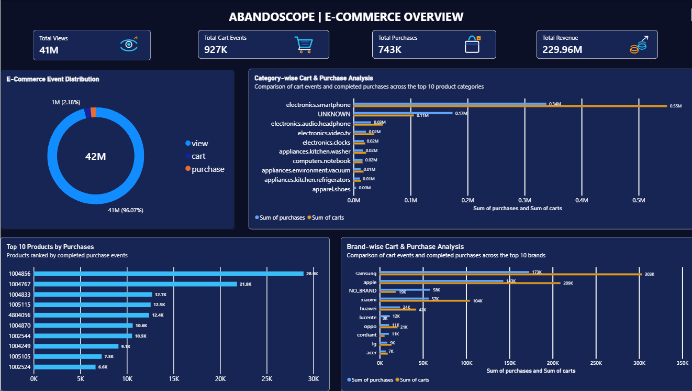
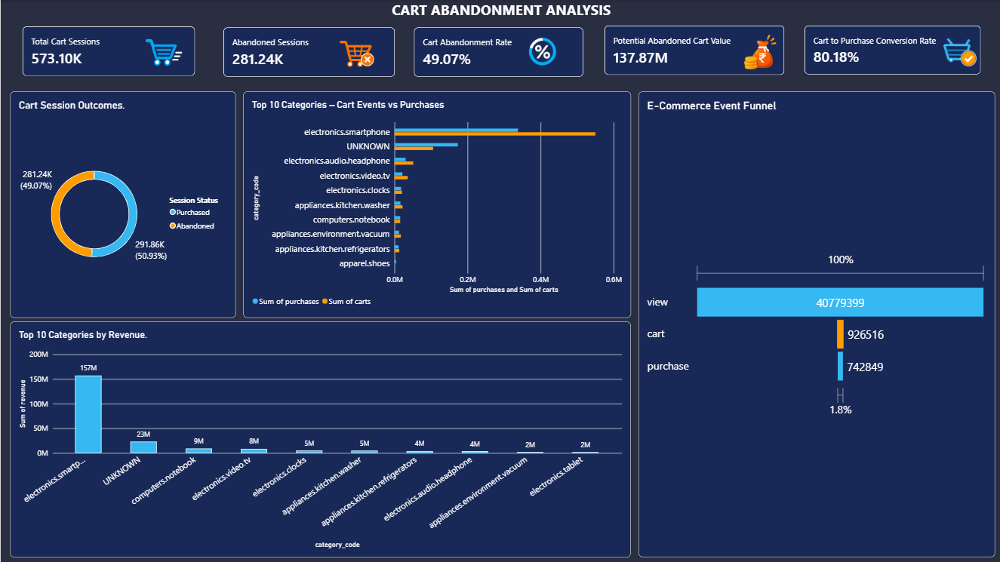
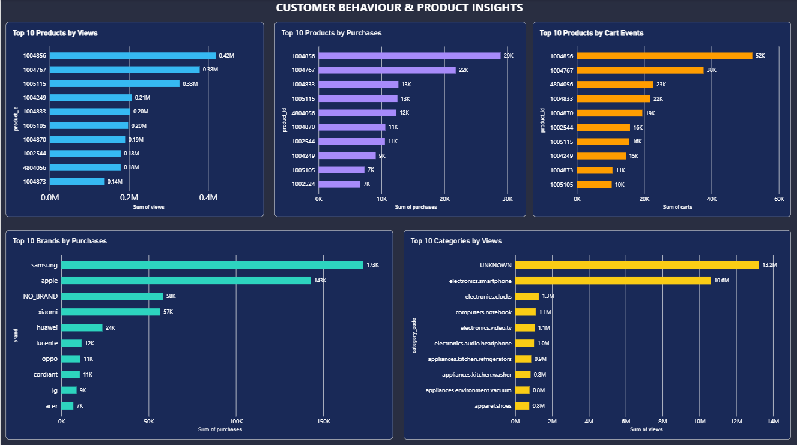

# AbandoScope

## E-Commerce Customer Behaviour & Cart Abandonment Analytics

AbandoScope is an E-Commerce Analytics project that explores customer browsing, cart activity, and purchase behaviour using event-level and session-level data. It combines Python-based data preparation, SQL analysis, and interactive Power BI dashboards to understand product performance, customer behaviour, conversion trends, and cart abandonment patterns.

## Project Objectives

- Understand the distribution of view, cart, and purchase events.
- Analyse customer sessions that contain cart activity but no purchase.
- Examine product, brand, and category performance.
- Estimate the value associated with potentially abandoned carts.
- Present key findings through interactive Power BI dashboards.

## Dataset

This project uses the **REES46 E-Commerce Behavior Data from a Multi-Category Store (October 2019)** dataset.

The raw dataset is large and is not included in this repository. Download the October 2019 source dataset from Kaggle and place it in `data/raw/` using the filename expected by the project scripts.

**Dataset source:**  
[Kaggle – E-Commerce Behavior Data from a Multi-Category Store](https://www.kaggle.com/datasets/mkechinov/ecommerce-behavior-data-from-multi-category-store)

## Technology Stack

- **Python and Pandas** – Data cleaning, preparation, and analysis
- **SQL** – Database scripts and analytical queries
- **Power BI Desktop** – Interactive dashboards

## Project Workflow

1. **Data Preparation:** The raw October 2019 event data is cleaned and prepared for analysis.
2. **Exploratory Data Analysis:** Event distribution, category performance, brand performance, and product performance are examined.
3. **Session Analysis:** Customer sessions are assessed for cart activity and purchase activity.
4. **KPI Generation and Validation:** Summary metrics and validation outputs are generated.
5. **Dashboard Development:** Prepared CSV summaries are used to create interactive Power BI dashboards.

## Cart Abandonment Definition and Interpretation

For this project, an **abandoned session** is defined as a session with at least one cart event and no purchase event.

The cart abandonment rate is calculated as:

`Abandoned Sessions / Sessions with Cart Activity`

This is a session-level definition based on the available event data. The source dataset does not contain an explicit checkout event, so this project does not measure checkout abandonment.

**Potential Abandoned Cart Value** is an estimate based on cart-event values in sessions classified as abandoned. It should not be interpreted as confirmed lost revenue because repeated cart events may affect the estimate.

The cart-to-purchase conversion figure shown in the dashboard is an event-count ratio (purchase events divided by cart events), not a unique-session conversion rate.

## Power BI Dashboards

The Power BI report contains three interactive pages.

### 1. E-Commerce Overview

Provides an overview of event activity, revenue, category performance, and leading products and brands.



### 2. Cart Abandonment Analysis

Presents cart-session outcomes, abandonment KPIs, category comparisons, and the e-commerce event funnel.



### 3. Customer Behaviour & Product Insights

Highlights leading products by views, cart events, and purchases, along with brand and category insights.



To explore the interactive report, open `AbandoScope_Dashboard.pbix` in Power BI Desktop.

## Repository Structure

```text
AbandoScope_Analytics/
│
├── data/
│   ├── raw/                         # Original source data (not committed)
│   └── processed/
│       └── powerbi/                 # Prepared CSV summaries
│
├── docs/
│   ├── cleaning_report.md
│   ├── data_dictionary.md
│   ├── session_audit.tsv
│   └── validation_report.md
│
├── reports/
│   └── eda/                         # EDA report and generated charts
│
├── screenshots/                     # Power BI dashboard screenshots
│
├── scripts/                         # Python preparation and validation scripts
│
├── sql/                             # SQL setup, validation, and analysis queries
│
├── README.md
├── .gitignore
└── AbandoScope_Dashboard.pbix
```

## Running the Project

1. Install Python and the required packages used by the project scripts.
2. Download the October 2019 dataset from the Kaggle source linked above.
3. Place the source file in `data/raw/` and ensure its filename matches the input expected by the scripts.
4. Review the scripts in `scripts/` and run the data-cleaning and analysis workflow in the required order.
5. Use the generated CSV summaries in `data/processed/powerbi/` with Power BI Desktop.
6. Open `AbandoScope_Dashboard.pbix` in Power BI Desktop to explore the dashboards.

**Note:** The exact package list and script execution order should be documented from the project's actual environment before publishing setup instructions.

## Documentation

Additional project documentation is available in the `docs/` directory:

- `cleaning_report.md` – Data cleaning details.
- `data_dictionary.md` – Dataset fields and descriptions.
- `session_audit.tsv` – Session-level audit information.
- `validation_report.md` – Data validation results.

Exploratory analysis reports and generated charts are available in `reports/eda/`.

## Notes

- The multi-gigabyte raw and cleaned datasets are intentionally excluded from this repository.
- Temporary files, Python cache folders, and local environment files are excluded.
- Prepared Power BI CSV summaries are included in the repository.
- Dashboard screenshots are provided in the `screenshots/` directory.
- Verify the source dataset's licence and attribution requirements before redistributing any data.

## Author

**Aditi Chougule**

AbandoScope – E-Commerce Customer Behaviour & Cart Abandonment Analytics.
